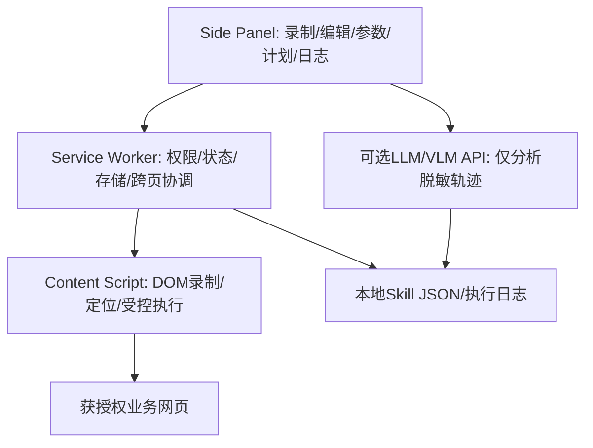

# 浏览器智能操作与技能复用插件：竞品调研与技术验证报告

> 调研基准日：2026-11-24  
> 对象：Chrome/Edge浏览器扩展，重点关注“人工示教一次→提取参数→复用执行→日志与问答”。  
> 证据范围：官方产品说明、Chrome商店说明、开源仓库README/许可、Chrome扩展官方文档。**未将厂商自述的功能等同于独立实测结论**。  
> 验证范围：已创建一套完整MV3扩展源码和本地测试页面，完成部分组件的自动化测试；受当前容器导航与扩展安装限制，未完成端到端真实浏览器扩展运行验证。

## 1. 摘要与关键判断

1. **类似插件不仅存在，而且已经非常接近目标产品。** Kimi Browser Extension的官方文档说明人工操作一次即可生成技能并可审核参数和步骤；360 VisFlow强调企业内部复杂流程、示教、执行确认与私有模型；Bnod、FlowTape已经包含录制、变量、询问/确认、复用与日志等能力。
2. **简单的“录制→回放”“参数化”“提示输入”“人工审批”均不足以作为独立创新。** 更具研究空间的是：一次示教下的**业务语义参数抽象**、跨步骤数据依赖、带证据的完成条件构造、异常处理边界与执行后**真实业务数据问答**。
3. **只做浏览器插件，技术路线可行，但要限定能力边界。** 纯MV3扩展可以采集获授权网页的DOM事件，生成结构化动作并在Content Script中执行；但不具备无条件的受信任鼠标事件、OS级输入、跨域/跨iframe能力。
4. **Codebase不建议直接Fork企业级全套RPA。** 优先构建轻量MV3插件；如果需要复用录制代码，优先深入审查MIT许可的 Browser Agent Recorder；如果需要“技能作为工具”的接口机制，可参考MIT的 Agent Process；对于Automa及Ui.Vision，关注其AGPL/商业授权及较大系统复杂度。
5. **对比实验不必增加太多竞品。** 保留成熟RPA与AI示教两种技术范式；考虑形态已收敛为插件，建议把 Ui.Vision 作为插件级RPA参考，Kimi/VisFlow作为直接产品竞品；是否替换既定的Power Automate Desktop、OpenAdapt基线由第一周可安装性决定。

## 2. 竞品全景表

标注：✅=官方明确说明；◐=可能通过配置实现，尚待验证；—=非核心产品定位；问号=官方资料不足。**不是独立测评结果。**

| 产品 / 项目 | 类型 | 人工录制 | 参数/复用 | AI理解 | 执行日志/验证 | 开源及部署判断 | 与本课题关系 |
|---|---|---|---|---|---|---|---|
| [Kimi Browser Extension](https://www.kimi.ai/help/kimi-browser-extension/kimi-browser-extension-use-cases) | AI技能插件 | ✅ | ✅审核步骤、参数后复用 | ✅ | ? | 非开源；架构与本地服务依赖需核验 | **最直接产品竞品** |
| [360 VisFlow](https://research.360.cn/en/products/VisFlow) | 企业示教Agent插件 | ✅ | ✅ | ✅视觉与任务理解 | ✅确认/安全机制 | 非开源；Chrome/Edge公测，支持模型服务配置 | **企业场景最重要对照** |
| [Bnod](https://chromewebstore.google.com/detail/dpkhclebgjddmfmfmcofnpncodinonmd) | 全功能工作流插件 | ✅ | ✅变量、子流程、导入导出 | ✅AI构建与澄清 | ✅本地逐步日志 | 商店产品，源码许可未确认 | **产品闭环对照** |
| [FlowTape](https://chromewebstore.google.com/detail/fbcldmefdekddelkgckinghldhlecehf) | 轻量工作流插件 | ✅ | ✅prompt运行时提问、条件分支 | 非主要功能 | ◐基本运行输出 | 商店产品，源码许可未确认 | **低成本参数化对照** |
| [Browserflow](https://browserflow.app/) | 无代码录制/网页自动化 | ✅ | ✅命名输入/输出与回放 | ◐AI辅助能力 | ◐ | 商业方案 | 通用工具对照 |
| [Axiom.ai](https://axiom.ai/docs/) | 无代码网页机器人 | ◐构建/录制步骤 | ✅表格输入、循环 | ✅AI构建 | ✅运行报告/调试 | 商业方案，可能依赖产品基础设施 | 批量填报场景参考 |
| [Ui.Vision RPA](https://ui.vision/rpa) | 传统/视觉RPA插件 | ✅ | ✅CSV/变量/宏 | ✅AI辅助、OCR | ✅宏执行与检查 | 开源，AGPL及相关商业许可须核验 | **成熟RPA基线候选** |
| [Automa](https://github.com/AutomaApp/automa) | 开源积木式自动化插件 | ◐图形化流程为主 | ✅ | ✅扩展AI能力 | ◐ | AGPL / 商业授权双轨或混合 | 技术架构参考，Fork较重 |
| [Browser Agent Recorder](https://github.com/VelvetAbyss/browser-agent-recorder) | 开源录制/技能包插件 | ✅ | ◐导出技能包/脚本 | — | 目标条件可编辑 | **MIT；纯MV3，主要负责录制与导出** | **录制代码候选** |
| [Agent Process](https://github.com/InlineManual/agentprocess) | WebMCP技能插件 | ✅通过配套Builder | ✅输入参数、工具调用 | ✅调用依赖外部AI | ✅历史 | **MIT；有配套录制工具依赖** | **技能接口设计参考** |
| [Step by Step](https://github.com/builtbystef/step-by-step) | 录制插件＋后台执行平台 | ✅ | ✅变量/密钥/批次 | 非主要能力 | ✅详尽轨迹、回放 | **MIT，但依赖PostgreSQL/Redis/Playwright Worker等后端** | 不能直接当纯插件底座 |
| [Chrome DevTools Recorder](https://developer.chrome.com/docs/devtools/recorder/overview) | 浏览器内开发者录制 | ✅ | 需改脚本 | — | 流程重放 | Google浏览器内置工具 | 录制技术基线/格式参考 |

附注：OpenAdapt、Browser Use、Stagehand、Power Automate Desktop仍可用于方法或商业基线对比，但**不是纯浏览器插件的同构架构**；其运行前置条件和成本应另列。

## 3. 需要重点分析的竞品

### 3.1 Kimi Browser Extension——高度接近当前产品设想

官方“Record actions as a skill”流程明确包括：用户在侧边栏选录制动作、演示、停止并生成技能、审阅技能名称/步骤/参数、保存、后续通过命令调用。其文档还提到将密码标记为秘密参数，在回放时再填写；也支持“将当前网站转成技能”“将当前会话保存为技能”。

**对我们的影响：** “录制一次自动得到Skill、参数可审阅、后续执行”不是差异化。需要在真实复杂业务里比较参数推断正确率、业务数据依赖和结果验证等，而不是靠功能清单打勾。**尚未独立实测其复杂业务准确率和纯插件无本地服务依赖情况。**

### 3.2 360 VisFlow——企业内网业务最值得对照

官方宣称企业内网ERP、批量表单、两分钟示教后的复杂任务、敏感信息掩码、高风险确认、用户既有登录态、私有模型接入等特性。公测网页与扩展商店均可查询。

**对我们的影响：** “面向企业、私有化模型、高风险确认、人工示教”同样不是独有。适合重点评估：长流程的状态检查、失败接管、批量操作幂等性，以及内网数据最小化采集策略。官方案例数据只能视为厂商提供的演示，不是可复制的研究结果。

### 3.3 Bnod与FlowTape——轻量插件已能覆盖大部分产品流程

Bnod商店描述含本地录制、编辑、重放、AI建流程、澄清问句、批准、分步日志、变量和子流程。FlowTape含丰富动作、变量替换、运行时`prompt`、`if/repeat`以及侧边栏。因此，简单的“运行时主动询问参数”并非新点。

**建议：** 不一定要全部安装评测，但必须作为相关工作写入报告。其官方说明未提供统一Benchmark下的独立质量数据，也未确认可合法复用的开源代码。

### 3.4 MIT开源选项：Browser Agent Recorder / Agent Process

Browser Agent Recorder为本地MV3扩展，记录操作、语义候选定位器、截图与隐私掩码，能导出Playwright/DevTools脚本及Agent Skill Pack；它主要解决“记录与输出”，并**不等于在同一插件中完成可靠自动执行和对话分析**。代码结构可参考其`src/content/recorder.ts`，但只有在审查许可证和集成工作量后才适合二次开发。

Agent Process能够将网页流程封装为含输入参数的WebMCP工具，给AI助手调用；录制通过配套Inline Manual Builder或流程JSON导入，它不是“一个扩展包覆盖所有产品模块”的现成代码库。

Step by Step虽然也是MIT且功能丰富，但后台需要多种服务，更适合自托管平台，不适合三周内作为无后端插件底座。

### 3.5 成熟RPA：Ui.Vision与Automa

Ui.Vision已经实现录制回放、CSV数据驱动填表、OCR与图像定位、宏和AI辅助工具，不能简单认为RPA不支持视觉或变量。Automa的图形化流程、变量与扩展构建思路非常成熟。但这两类项目的AGPL/商业授权条件和代码体积决定了**不建议直接复制其代码作自研产品**。有企业推广意图时尤其需要合规审查。

## 4. 重新界定技术创新点

根据上述现状，建议三周研究分为两个层次：

- **产品MVP（工程成果）：** 录制、结构化轨迹、生成技能、运行时参数补全、执行前确认、稳定回放、日志与简单问答。这些已是行业共性能力，不单独宣称算法创新。
- **可量化研究问题（建议选一个主攻）：**
  1. **一次示教下的语义参数/数据依赖推断。** 从一个样例识别哪些字段是变量、不同步骤间的值如何传递；对不确定项主动提问。用参数识别Precision/Recall、跨参数执行成功率、人工修订时间评估。
  2. **可信结果校验与数据证据。** 从操作轨迹与页面状态构建前后置条件，区别“点击成功”和“业务完成”，问答由实际日志/记录产生。用完成状态判断准确率、误判成功率、安全错误操作数评估。
  3. **按需视觉增强的成本收益。** 只有在DOM语义不足时调用VLM；相较全量视觉与纯DOM比较成功率和模型开销。优先依据第一周失败案例决定是否投入。

在5人/3周限制下，建议**优先1，必做2的基本机制，3作为可选研究**，而不是同时训练视频模型、做全站自主修复、开发桌面级自动化。

## 5. 纯浏览器插件技术路线

**关键原则：** 插件自身是一份Manifest V3扩展；脚本代码全部本地打包；调用外部模型只得到**结构化动作DSL/候选参数**，不把模型输出当任意JavaScript注入页面。权限采用`optional_host_permissions`在用户操作时按站点申请；Side Panel用于长流程交互；跨页调度通过Service Worker与持久化状态协调。

**必须接受的浏览器边界：** 普通`element.click()`产生的事件通常不是可信用户手势；有些站点要求真实输入或需要登录操作；跨域iframe、受保护Shadow DOM、文件选择器、系统页面、Canvas/远程桌面需单独处理。MV3 Service Worker可能休眠，长期执行必须设计断点与恢复。不能声称纯插件能支持所有企业业务系统。

## 6. 已完成的技术Spike：SkillFlow Probe v0.1

源码位置：随附`skillflow_mvp_浏览器插件技术验证.zip`。

### 6.1 实现了什么

- 完整Chrome/Edge MV3插件工程结构：`manifest.json`、后台Service Worker、Content Script、侧边栏及本地存储；无独立业务后端。
- 按用户操作申请当前站点权限；仅在录制状态下采集当前标签页的点击、输入、选择、Enter、导航事件；过滤密码等疑似敏感输入；URL去除查询参数与片段。
- 将录制步骤转换为JSON，按字段标签建议变量名；用户审阅后保存技能；后续修改变量并人工确认执行计划。
- 页面级DOM回放，结果CSS选择器检查，本地执行日志，简单规则式日志问答；对部分高风险动作单独确认。
- 独立HTML模拟测试业务页面与自动化组件测试脚本。

### 6.2 验证等级与结果

| 测试 | 方法 | 结果 |
|---|---|---|
| 静态语法 | Node `--check`全部JS，JSON清单解析 | **通过** |
| DOM点击/输入事件采集 | 在Chromium页面加载Content Script，注入模拟扩展消息接口 | **通过** |
| 日期字段录制 | 发现`input[type=month]`的自动化输入事件可能是非可信事件；补充真实失焦捕获 | **通过（组件级）** |
| 参数化执行 | 将A单位、2026-10替换成B单位、2026-11，执行DOM填写与查询 | **通过（组件级）** |
| 结果元素检查 | 查询`#result`并读到对应模拟文本、data-status=ok | **通过（组件级）** |
| 敏感输入值过滤 | 使用密码字段输入虚构敏感字符串，确认不在采集轨迹中 | **通过（组件级）** |
| MV3扩展侧边栏→站点权限→录制→持久化→回放端到端 | 当前受限Chromium容器中自动加载扩展及对本地网页导航受到限制 | **尚未通过，不得声称验证完成** |
| 真实电力业务站点、跨域与iframe、高风险提交 | 尚无授权测试环境 | **未测试** |

> 注意：组件测试中使用Chromium的普通网页执行环境，模拟扩展消息接口；不等于实测Chrome扩展权限模型。自动化测试中的原生日期输入有特殊事件特征，不能据此推导真实用户输入的所有行为。

### 6.3 如何在普通电脑上复测

1. 解压ZIP，运行 `python -m http.server 8765 --directory demo-site`。
2. Chrome/Edge打开 `http://127.0.0.1:8765/index.html`。
3. `chrome://extensions` → 开发者模式 → 加载已解压的扩展程序 → 选择`extension/`。
4. 通过工具栏图标打开侧边栏，在业务测试网页操作前点击“开始录制”，对该站点授权。
5. 输入A单位、2026-10并查询；停止录制、审核动态参数、结果选择器输入`#result`并保存。
6. 载入技能，将单位改为B单位，月份改为2026-11，确认计划并回放；检查网页结果和插件日志。

此流程属于**待进行人工安装复核的验收步骤**。若遇到Chrome安全策略禁用本地未签名插件、浏览器自动化策略限制、页面脚本无法注入，应记录失败证据，不能擅自绕过企业安全管控。

## 7. 是否直接采用开源代码库？

| 方案 | 优点 | 成本/风险 | 选择 |
|---|---|---|---|
| 从零实现整个浏览器运行时 | 自主性高 | 重复造轮子、不可控 | 不推荐 |
| Fork Automa/Ui.Vision | 大量现成RPA功能 | 体量大、AGPL/商业许可、产品形态改造 | 不推荐作为三周主代码库 |
| Fork Browser Agent Recorder | MIT、MV3、精细操作录制和隐私机制 | 缺少同插件执行与结果问答，仍需新增核心模块 | **值得再做半天源码审查** |
| Fork Agent Process | MIT、参数化技能/WebMCP工具抽象 | 录制需要配套Builder，完整流程不同 | 主要参考技能接口 |
| **自建薄MV3插件，复用规范与必要开源思路** | 可控、代码少、便于做参数语义研究 | 需自己承担录制稳定性和执行维护 | **当前推荐** |

注意：许可证结论基于公开仓库顶层声明，**不构成法律审核**；要用于公司内部推广，还需核对所有依赖、第三方素材及许可证义务。

## 8. Benchmark和三周研发建议（仅对关键项进行调整）

- **第一周**：先安装体验Ui.Vision或Power Automate Desktop其中1个RPA代表，以及Kimi或VisFlow其中1个AI示教插件；OpenAdapt继续做技术文献与能力参考。冻结6个业务任务、18个测试实例。优先完成插件端到端测试（目前是最大未验证环节）。
- **第二周**：在Probe基础上开发参数语义推断、人机确认和技能复用完整链路；必要时引入VLM补足DOM失败场景。自研MVP不是“把外部产品名称替换一下”，要在参数推断或验证方面形成实测差异。
- **第三周**：将最少两个现有工具与Ours放在统一Benchmark进行测试；分别统计首次配置人工成本、重复执行成功率、任务耗时、维护成本、错误提交和真实业务结果。完成报告及演示。

建议**不要同时正式评测PAD、Ui.Vision、Automa、OpenAdapt、Kimi、VisFlow、Bnod、Browser Use八种产品**。调研可以覆盖全面，正式基线保持2个即可。

## 9. 关键资料与官方链接

- Kimi浏览器扩展：[使用案例（示教生成技能）](https://www.kimi.ai/help/kimi-browser-extension/kimi-browser-extension-use-cases)、[2026-11-17产品介绍](https://www.kimi.ai/resources/kimi-browser-extension)
- 360 VisFlow：[产品官网](https://research.360.cn/en/products/VisFlow)、[用户手册](https://research.360.cn/en/VisFlow/usage-guide)、[Chrome商店](https://chromewebstore.google.com/detail/igpiakekcdcobakmgnoepkblboobanjl)
- Bnod：[Chrome商店](https://chromewebstore.google.com/detail/dpkhclebgjddmfmfmcofnpncodinonmd)
- FlowTape：[Chrome商店](https://chromewebstore.google.com/detail/fbcldmefdekddelkgckinghldhlecehf)
- Browserflow：[官网](https://browserflow.app/)、[文档](https://browserflow.io/docs)
- Axiom.ai：[产品文档](https://axiom.ai/docs/)、[AI数据填报](https://axiom.ai/automate/ai-data-entry/)
- Ui.Vision：[官网](https://ui.vision/rpa)、[官方代码](https://github.com/A9T9/RPA)、[Chrome商店](https://chromewebstore.google.com/detail/gcbalfbdmfieckjlnblleoemohcganoc)
- Automa：[官方代码和许可](https://github.com/AutomaApp/automa)、[文档](https://www.goautoma.com/extension/docs/)
- Browser Agent Recorder：[GitHub](https://github.com/VelvetAbyss/browser-agent-recorder)
- Agent Process：[GitHub](https://github.com/InlineManual/agentprocess)
- Step by Step：[GitHub](https://github.com/builtbystef/step-by-step)
- Chrome开发规范：[Side Panel](https://developer.chrome.com/docs/extensions/reference/api/sidePanel)、[Scripting](https://developer.chrome.com/docs/extensions/reference/api/scripting)、[Permissions](https://developer.chrome.com/docs/extensions/reference/api/permissions)、[Service Worker lifecycle](https://developer.chrome.com/docs/extensions/develop/concepts/service-workers/lifecycle)
- Web事件可信标记：[Event.isTrusted](https://developer.mozilla.org/en-US/docs/Web/API/Event/isTrusted)

## 10. 仍需真实环境解答的关键问题

1. 企业终端浏览器是否允许安装、按需授权和注入MV3插件？Chrome/Edge版本及策略是什么？
2. 拟演示的业务网页是否使用跨域iframe、Shadow DOM、Canvas、复杂前端框架、受信任事件校验？
3. 登录态/令牌如何获得授权并复用，是否禁止模型访问页面敏感信息？
4. 模型API是否可以调用企业内网网关，有无数据脱敏和审计要求？
5. 查询/填报的正确结果如何从后端业务状态验证，而不仅靠网页提示？
6. 同一工作流出现不同业务分支时，是否允许补充示教或通过人工确认抽象？

**结论：现有插件足够多，验证项目更应该关注“可靠业务技能学习与可信复用”，而不是重新证明浏览器能录制点击。初步组件测试证明纯插件技术路径的一部分可行，但完整MV3扩展实装与跨系统可靠性尚未完成验证。**
